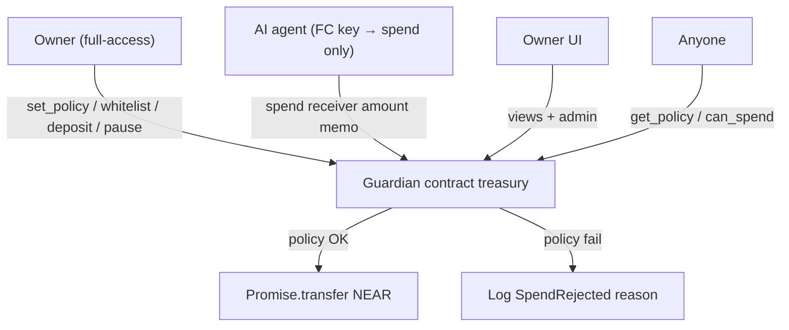

# Bound

**Autonomy, within bounds.**

**Give agents a budget, not a blank check — enforced on-chain, verifiable by anyone.**

AI agents on NEAR need to spend money. Giving them a full-access key is reckless; opaque off-chain policy is hard to audit. **Bound** keeps the treasury in a contract and lets agents call only `spend`, with **public** limits and whitelist enforced atomically every time.

**Hackathon tracks:** `security` · `agents`
**Event:** [NEAR HACKATHON](https://nearhackathon.com/) (submit by **14 Nov 2026, 23:59 UTC**)

> Honest claim: this is **not** “more secure than OutLayer.” OutLayer isolates keys in TEE. We make **budgets transparent and exact** for open treasuries, DAOs, and builders who want policy anyone can verify on-chain.

---

## Problem

1. Agent wallets without limits can be drained by a buggy or prompt-injected agent.
2. NEAR’s Function Call access keys **cannot** transfer NEAR — perfect for scoping agents to a policy contract — but few demos ship the full pattern.
3. TEE custody (e.g. OutLayer) is excellent for production key isolation; open / composable on-chain budget accounting is still a gap.

## Differentiation vs OutLayer

| | **OutLayer** | **Bound** |
|---|---|---|
| Agent key material | No chain key (API → TEE signs) | Function Call key scoped to `spend` only |
| Policy visibility | Encrypted; evaluated in TEE | **Public on-chain** (`get_policy`) |
| Daily / velocity limits | Best-effort under concurrency | **Exact** — `spent_today` + day bucket, atomic |
| Trust model | Hardware attestation + operator infra | Contract code + NEAR consensus |
| Integration | Custody / API product | **Composable** — any account with FC key can call |
| Best fit | Production multi-chain custody | Open treasuries, hackathon agents, auditable demos |

Complementary, not competitive: OutLayer isolates keys; Bound makes budgets verifiable.

---

## Architecture



```
Owner (full access)
  └─ deploy guardian + set_policy + deposit + whitelist
Agent (FC Key → guardian::spend only)
  └─ propose payments to vendors
Guardian contract
  └─ whitelist → max_per_tx → daily remaining → transfer | reject + log
```

**Out of scope for this MVP:** TEE, encrypted policy, NEAR Intents settlement (future: `spend_via_intent`), multisig DAO, multi-chain signing.

---

## Repo layout

```
contracts/agent-guardian/   # Rust near-sdk contract + unit tests
scripts/                    # Node demo agent skeleton (3 scenarios)
frontend/                   # UI placeholder (policy editor + feed)
HACKATHON.md                # Submit checklist + demo script
```

---

## Build & test

### Prerequisites

- Rust **1.88+** (repo includes `rust-toolchain.toml`; `rustup` will auto-select)
- `cargo`
- Node 18+ for the demo script (later)

### Contract unit tests

```bash
cd contracts/agent-guardian
cargo test
```

### Build WASM (when ready to deploy)

```bash
cd contracts/agent-guardian
rustup target add wasm32-unknown-unknown
cargo build --release --target wasm32-unknown-unknown
# artifact: target/wasm32-unknown-unknown/release/agent_guardian.wasm
```

> **Dependency note:** `Cargo.toml` pins `near-sdk` via **git tag `near-sdk-v5.17.2`** so this environment can fetch when crates.io API is flaky. On a normal network you may switch to `near-sdk = "5.17.2"` (or current 5.x) with `features = ["unit-testing"]` in `[dev-dependencies]`.

---

## Do X → see Y (AI screener / judges)

1. **Deploy & init** on testnet with `max_per_tx` / `daily_limit` in yoctoNEAR.
2. **Owner** calls `add_to_whitelist(vendor.testnet)` and deposits NEAR (`deposit` with attached deposit, or transfer to contract).
3. **Add FC key** on the agent account: only `guardian.testnet` / method `spend` (no `transfer` permission — FC keys cannot transfer NEAR anyway).
4. **Run allowed spend** → explorer log contains `SpendAllowed`; vendor balance increases.
5. **Run over `max_per_tx`** → `SpendRejected` / `over_max_per_tx`; `spent_today` unchanged.
6. **Run non-whitelist receiver** → `SpendRejected` / `not_whitelisted`.
7. **Prove FC key cannot native-transfer** → same key fails a direct NEAR transfer (protocol-level).
8. **View** `get_policy` / `can_spend` — policy is public.

Detailed submit notes: [`HACKATHON.md`](./HACKATHON.md).

---

## Policy rules (MVP)

On every `spend(receiver, amount, memo)`:

1. Not `paused`
2. `receiver` ∈ whitelist
3. `amount ≤ max_per_tx`
4. `spent_today + amount ≤ daily_limit` (after rolling UTC day bucket)
5. Contract balance ≥ `amount`
6. Then transfer + bump `spent_today`

Day bucket: `floor(block_timestamp_ns / 86_400_000_000_000)`.

---

## License

MIT — see [`LICENSE`](./LICENSE).
